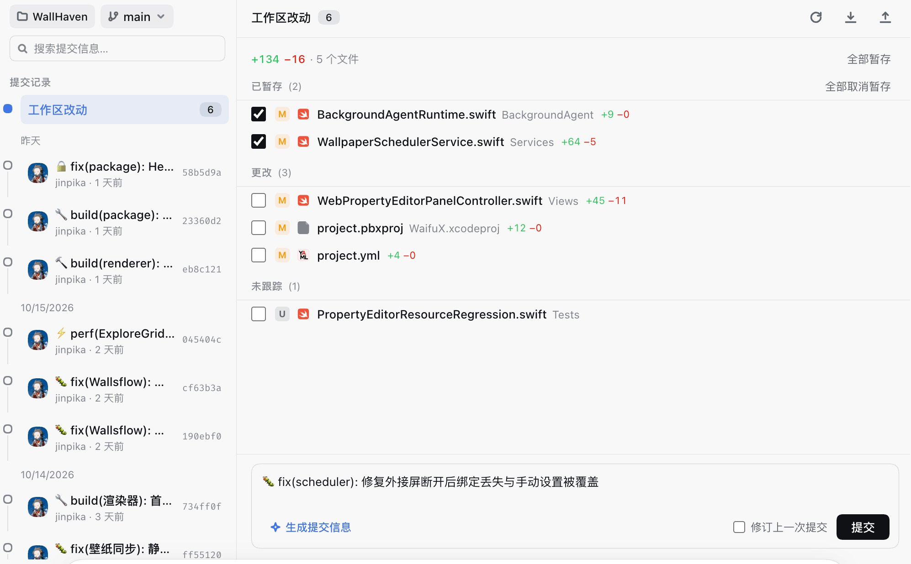

# dsh-git-plus

会话详情页的「Git」tab —— 当前会话工作目录是 git 仓库时自动出现（`git init` 后 ≤5s），提供完整仓库操作控制台。

## 📸 界面预览



## 功能

**双栏布局**（GitHub Desktop / Fork 形态）：左栏 260px —— 仓库 chip + 分支下拉 chip（点击下拉切换全部分支，当前分支打勾选中，下拉底部可新建分支）、提交搜索框、提交记录时间轴（「工作区改动」固定节点带脏计数 + 日期分组 + 头像 + subject + 作者·相对时间 + sha）；右栏随左栏选中切换两种视图。

**工作区视图**：头部（工作区改动 + 计数 + fetch/pull/push 图标组，悬停有文字提示，禁用态也能看，无远程时禁用并提示原因）；Staged / Changes / 未跟踪分段（空段隐藏；各分段标题前有全选勾选框，一键整组暂存/取消暂存；摘要行右侧「全部暂存」）；行 = 复选框 | 状态徽标 | 文件图标 | 主名+目录 | ±统计 | ⋯菜单；点行开 diff 覆盖面板（推入/推出同路）；底部 composer 卡（消息 + 生成提交信息 + amend + 提交）。

**commit 详情视图**：头像 + subject + 完整/相对时间 + sha 复制芯片 + body 正文；文件列表卡（点击内联展开该文件 diff）；composer 隐藏。

## 动态显隐机制

- client 半边在 `conversation.session.header.utilities`（list slot）挂隐形 Probe（渲染 null 不占位），探测当前会话 cwd 是否 git 仓库。⚠️ 勿挂 single slot：single 只渲染最低 priority 条目，Probe 会永不执行。
- 官方 `slots.inject` 的「等声明」语义保证时序（slot 未声明时不执行、声明后自动 reconcile）。
- 未注册态 5s 轮询 → `git init` 后 ≤5s tab 自动出现；非仓库会话 tab 摘除。
- cwd 由 **host 侧** sessions / sessionQuery 服务解析（`header.cwd`，照 dsh-video-preview 的 `sessionCwdOf` 三级回退）—— client 不依赖 snapshot 形状。

## 架构

```
~/.dsh/local-plugins/dsh-git-plus/
├── lib/index.js   host 半边：/dsh-git-plus 前缀路由（GET 只读 + POST /action 白名单）
└── lib/client.js  client 半边：tab 注册 + 显隐 Probe + 双栏 UI
```

host 路由：

```
GET  /health /git-info /status /file-diff /log /show-diff /branch-list
POST /action   {action: stage|stage-all|unstage|unstage-all|discard|commit|
                amend|switch|create-branch|fetch|pull|push, sessionId, args}
```

## 安全纪律

- git 全部 `execFile` argv 数组，无 shell；文件名 `-z` NUL 分隔
- cwd：`sessions.get(sessionId).header.cwd` → `sessionQuery.observeSession` 持久查询 → `cwd` 参数；realpath 归一 + 系统目录拒绝表（`/Volumes` 用户代码卷放行，仅拒 TM 备份挂点）
- 文件参数归一后必须仍在 cwd 内（`..`/绝对/符号链接逃逸 → 403）；分支名过 `git check-ref-format --branch`
- 写操作互斥队列（防 `index.lock` 并发）；读 10s / 写 10s / 网络 30s 超时；stdout 4MB 封顶（超限降级 oversized）
- discard / push / 已推送 amend 走官方 RiskConfirmation 两段确认

## 测试

```bash
node /tmp/dsh-git-plus-host-test.mjs   # 55 项：解析器 + scratch 仓库全回路 + 注入/逃逸/空仓库
```

## 回滚

删除 desktop profile `cordis.patch.yml` 里的 `dsh-git-plus` insert 块 + `package.json` 依赖行，重启应用。

---

## ☕ 支持开源

dsh-git-plus 是一个**完全免费、开源**的个人项目。开发和维护一个 DSH 插件需要投入大量业余时间——从交互设计到功能实现，从 Bug 修复到 DSH 版本适配，每一个版本背后都是持续的投入。

如果你觉得它对你有帮助，欢迎通过以下方式支持项目的持续发展：

<p align="center">
  
  
</p>

当然，**给项目点个 Star ⭐️** 同样是对开发者最大的鼓励！

每一份支持都是我继续维护和迭代的动力。感谢使用 💜
test-change
